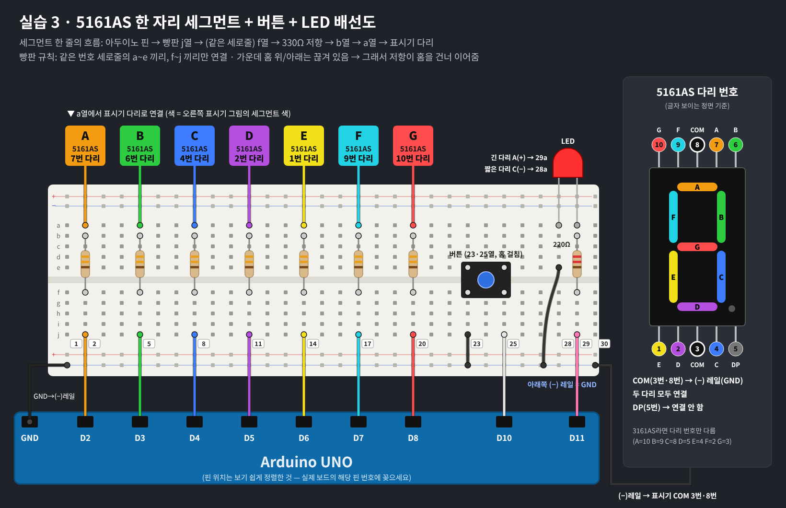

# 실습 3 · 7세그먼트 실습 중 어려웠던 점

> **실습 내용**: 한 자리 7세그먼트 + 버튼 + LED (버튼 누를 때마다 0~9 증가)
> **사용 부품**: Arduino UNO · 5161AS (공통 캐소드 7세그먼트) · 330Ω ×7 · 220Ω ×1 · 버튼 · LED



코드: [button_counter.ino](button_counter.ino)

> 핵심 고민 요약표는 [README](../README.md#실습-3--7세그먼트--버튼--led)에 있어요.

## 목차

1. [세그먼트, 캐소드, COM이 뭘까?](#1-세그먼트-캐소드-com이-뭘까)
2. [COM 다리는 어디일까?](#2-com-다리는-어디일까)
3. [뭐가 고정이고 뭘 바꿔도 될까?](#3-뭐가-고정이고-뭘-바꿔도-될까)
4. [배선표의 다리 번호는 왜 뒤죽박죽일까?](#4-배선표의-다리-번호는-왜-뒤죽박죽일까)
5. [연결 순서를 마음대로 바꿔도 될까?](#5-연결-순서를-마음대로-바꿔도-될까)
6. [선만 바꾸면 왜 숫자가 깨질까?](#6-선만-바꾸면-왜-숫자가-깨질까)
7. [정리](#정리)

---

## 1. 세그먼트, 캐소드, COM이 뭘까?

> ❓ **처음 생각**: 실습 설명의 "공통 캐소드(COM=GND)"가 무슨 뜻인지 몰라 회로 자체를 이해 못 함
>
> ✅ **결론**: 막대 하나가 LED 하나이고, COM은 7개 LED의 (−)를 묶은 다리

| 용어 | 뜻 |
|---|---|
| **세그먼트** | '조각'이라는 뜻. 숫자를 이루는 **막대 하나하나**를 말함. 막대가 7개라서 7세그먼트 |
| **애노드 (Anode)** | LED의 **(+) 다리**. 긴 다리 |
| **캐소드 (Cathode)** | LED의 **(−) 다리**. 짧은 다리 |
| **COM (Common)** | 7개 LED의 한쪽 다리를 **안에서 하나로 묶어 밖으로 뺀 다리** |

- 막대 하나 = **LED 하나**
- **공통 캐소드**: 7개 LED의 **(−)를 하나로 묶은** 방식
  - COM은 **GND**에 연결, 켤 막대에 **HIGH(5V)**를 줌
- **공통 애노드**: (+)를 묶은 방식
  - COM은 **5V**에 연결, 켤 막대에 **LOW**를 줌 → 코드가 정반대가 됨

---

## 2. COM 다리는 어디일까?

> ❓ **처음 생각**: 다리 10개 중 가운데 다리가 COM인 것 같은데 확신 없음
>
> ✅ **결론**: 맞음. 위·아래 줄의 가운데 다리(8번, 3번)가 COM

5161AS의 COM은 **위·아래 줄 각각의 가운데 다리(8번, 3번)**. 두 다리는 안에서 서로 연결돼 있음.

```
 위:   10   9  [8]   7   6     ← 8번 = COM
 아래:  1   2  [3]   4   5     ← 3번 = COM
```

- 다리 번호는 **글자가 보이게 정면으로 놓고 왼쪽 아래가 1번**, 반시계 방향으로 셈
- 5번 다리는 **DP(점)**. 이번 실습에서는 사용 안 함

---

## 3. 뭐가 고정이고 뭘 바꿔도 될까?

> ❓ **처음 생각**: 막대 이름(A~G), 다리 번호, 아두이노 핀 번호가 전부 정해져 있는 건지 구분 못 함
>
> ✅ **결론**: 막대 이름·다리 번호는 고정, 다리 ↔ 아두이노 핀 연결은 자유

**막대 이름은 모든 제품이 같음.** 맨 위 A부터 시계 방향으로 돌고, 가운데가 G.

```
    A
  F   B
    G
  E   C
    D   • DP
```

| 연결 | 고정? | 누가 정하나 |
|---|:---:|---|
| 막대 위치 ↔ 글자 (A~G) | 🔒 고정 | 모든 제품 공통 규칙 |
| 글자 ↔ 다리 번호 | 🔒 고정 | 부품 회사 (제품마다 다름, 데이터시트에 나옴) |
| 다리 ↔ 아두이노 핀 | 🔓 **자유** | **사용자** (코드와 맞추기만 하면 됨) |

- 같은 A 막대라도 **5161AS는 7번 다리**, **3161AS는 10번 다리**
- 아두이노 **D0, D1은 피하는 게 좋음** (업로드·시리얼 통신용 핀)

---

## 4. 배선표의 다리 번호는 왜 뒤죽박죽일까?

> ❓ **처음 생각**: 표의 `7 → 6 → 4 → 2 …`를 아두이노 핀이 왼쪽부터 그 번호인 줄 착각함
>
> ✅ **결론**: 아두이노 핀이 아니라 표시기 다리 번호. 막대 순서(A~G)에 맞추다 보니 뒤죽박죽이 됨

이 숫자는 **아두이노 핀이 아니라 표시기 다리 번호**.
배선표를 **아두이노 핀 순서 = 막대 A, B, C… 순서**로 맞춰 정리했기 때문에 다리 번호 쪽이 연속적이지 않음.

| 아두이노 | 막대 | 5161AS 다리 |
|:---:|:---:|:---:|
| D2 | A (맨 위) | 7번 |
| D3 | B (오른쪽 위) | 6번 |
| D4 | C (오른쪽 아래) | 4번 |
| D5 | D (맨 아래) | 2번 |
| D6 | E (왼쪽 아래) | 1번 |
| D7 | F (왼쪽 위) | 9번 |
| D8 | G (가운데) | 10번 |
| GND | COM | 3번 · 8번 |

> 다리 번호마다 막대(A~G)가 할당돼 있음 → 영어 순서를 연속으로 맞추다 보니 다리 번호가 띄엄띄엄이 됨

---

## 5. 연결 순서를 마음대로 바꿔도 될까?

> ❓ **처음 생각**: D2에 10번, D3에 9번 … 다리 번호 순서대로 쭉 연결하면 되는 줄 앎
>
> ✅ **결론**: 순서는 바꿔도 되지만 COM(3·8번)·DP(5번)는 빼야 하고, 코드 핀 배열도 수정해야 함

**가능함.** 단, 두 가지는 지켜야 함.

1. **COM(3·8번)은 GND에, DP(5번)는 연결 안 함** → 아두이노 핀에 꽂으면 안 됨
2. **코드의 핀 배열도 같이 바꿈**

| 아두이노 | 막대 | 5161AS 다리 |
|:---:|:---:|:---:|
| D2 | G | 10번 |
| D3 | F | 9번 |
| D4 | E | 1번 |
| D5 | D | 2번 |
| D6 | C | 4번 |
| D7 | B | 6번 |
| D8 | A | 7번 |

```cpp
// 원래 배선 (A, B, C, D, E, F, G 순서)
int segPins[] = {2, 3, 4, 5, 6, 7, 8};

// G부터 거꾸로 배선했을 때
int segPins[] = {8, 7, 6, 5, 4, 3, 2};   // A=D8, B=D7, ... G=D2
```

---

## 6. 선만 바꾸면 왜 숫자가 깨질까?

> ❓ **처음 생각**: D2(A)와 D8(G) 선을 바꿔 꽂으면 0이 이상하게 나온다는 게 이해 안 됨
>
> ✅ **결론**: 코드는 핀 기준으로 신호를 보내기 때문에, 선이 바뀌면 엉뚱한 막대가 켜짐

코드는 **"D2 = A, D8 = G"라고 믿고** 신호를 보냄.

1. 0을 띄우려고 **D2~D7 = HIGH** (A~F 켜기), **D8 = LOW** (G 끄기)로 보냄
2. 그런데 실제로는 **D2 선 → G 다리**, **D8 선 → A 다리**에 꽂혀 있음
3. 결과
   - D2가 HIGH → **G(가운데)가 켜짐** ❌ 원래 꺼져야 함
   - D8이 LOW → **A(맨 위)가 꺼짐** ❌ 원래 켜져야 함

```
  원하는 0          실제로 나온 모양
   ━━━
  ┃   ┃             ┃   ┃
                     ━━━
  ┃   ┃             ┃   ┃
   ━━━               ━━━
```

> 코드는 시킨 대로 보냈는데, **신호가 엉뚱한 막대로 배달된 것**

---

## 정리

- 막대 하나 = LED 하나. **켤 막대에 HIGH**를 주면 켜짐 (공통 캐소드는 COM을 GND에 연결)
- **글자 ↔ 다리 번호**는 부품마다 정해져 있음 → **데이터시트나 배선표 확인 필수**
- **다리 ↔ 아두이노 핀**은 자유롭게 정해도 됨 → 단, **배선과 코드 핀 배열은 반드시 일치**
- 숫자가 이상하게 나오면 **배선과 코드 핀 배열부터 확인**
